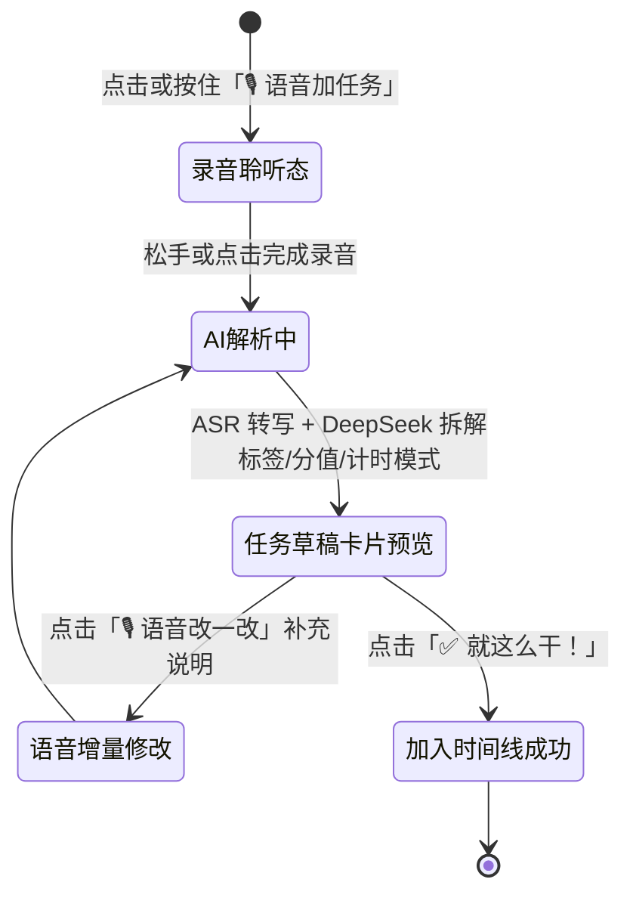

# 小星伴学（StudyDiary）— UI/UX 多端与适儿化交互设计方案（v1.0）

## 1. 设计原则（女孩向像素风 · 6–12 岁小学生优先）

1. **Kawaii Pixel Diary Aesthetic（女孩向甜系像素手账美学）**
   - **视觉主基调**：采用「草莓牛奶像素手账 / 魔法学园养成记」视觉语言。硬朗清晰的像素阶梯描边（`3px` 莓果深棕轮廓 `#4A2545` + `4px` 无模糊像素硬投影）、8-bit 像素精灵头像、星星沙漏、像素印章与海星小老师（Stella）动态精灵。
   - **甜系护眼色板**：主背景采用草莓奶油方格底 `#FFF5F9`（专注计时舱可切换星空紫夜护眼色 `#241B35`），搭配樱桃粉 `#FF7EB6`、星云紫 `#B589FF`、奶油黄 `#FFE066`、薄荷绿 `#6EE7B7`。
2. **Voice-First，Zero-Keyboard（全语音零键盘）**
   儿童主流程中**不出现任何必须手动打字的文本输入框**。所有输入均由「🎙️ 语音输入 + 📷 拍照 OCR + 👆 大像素胶囊点选」完成；转写出的文字仅作为视觉确认与家长查阅辅助，同时配以海星老师语音播报（DeepSeek TTS `stella`）。
3. **Big, Warm & Clear（大热区、像素图标、强反馈）**
   - **大触控标准**：所有可点击控件最小尺寸 `56×56px`，核心像素主按钮（说话、开始闯关、交成果）尺寸 `72~96px`，按钮间距 `>= 16px`，按下具备 `translate(2px, 2px)` 真实像素按键回弹感與轻柔 8-bit 音效。
   - **学科像素精灵编码**（像素图标 + 色彩双通道，低年级看图标秒懂）：
     - 📕 **语文**：樱桃珊瑚 `#FF6B8B`（像素魔法书/羽毛笔）
     - 📘 **数学**：晴空苏打 `#5CA8FF`（像素水晶算盘/星盘）
     - 📗 **英语**：薄荷奶绿 `#38C695`（像素 ABC 蝴蝶结）
     - 📙 **科学/艺术**：奶油蜜橘 `#FFAD42`（像素调色盘/放大镜）
     - 📔 **绘本阅读**：香芋星紫 `#A678FF`（像素独角兽故事书）
4. **One Codebase, Adaptive Layout（一套代码三端原生感）**
   通过 CSS Grid / Flexbox 断点与容器查询，让 iPad / Android Pad 横屏拥有桌面级双栏像素手账本效率，而手机竖屏保持单手拇指流体验。

---

## 2. 强制横屏锁定与固定可用分辨率架构（Locked `1280 × 800` Landscape Stage）

- **可用逻辑分辨率锁死（`1280 × 800` 黄金 16:10 横屏舞台）**：
  - 彻底取消竖屏单列重排与字号忽大忽小问题，全局锁定 **`1280px × 800px`** 固定逻辑分辨率舞台，一屏到底无整页滚动（左侧日历+局部滚动时间线 `756px`，右侧能量舱+海星老师看板 `476px`）。
  - 针对不同物理屏幕（iPad `1024×768` / `1180×820` / `1366×1024`、Android Pad `1280×800` / `2000×1200`、手机横屏 `844×390` ~ `932×430`），通过 `LockedLandscapeStage` 等比无损缩放适配。
- **双重强制横屏锁**：
  1. PWA `manifest.webmanifest` 声明 `"display": "fullscreen", "orientation": "landscape"`，并在交互时调用 `screen.orientation.lock('landscape')`。
  2. 当检测到物理视口处于竖屏（`innerWidth < innerHeight`，如 iOS Safari 系统限制未锁住方向时），舞台容器自动执行 **`90°` 横向旋转铺满全屏**，所有弹窗均挂载于横屏舞台内部，确保任何姿态下 100% 强制横屏呈现。
- **像素图形 + 非像素大字号护眼字体**：
  - 精灵头像、星星勋章、卡片硬边保持甜美像素手账风；**全部文字与数字严禁使用像素锯齿字体**，统一采用高清晰抗锯齿系统圆润无衬线字体（`PingFang SC` / `HarmonyOS Sans SC` / `Microsoft YaHei UI` + `tabular-nums` 等宽数字）与低眩光暖米护眼纸色（`#FBF5EE`），正文字号提升至 `16px–18px`、标题与主按钮 `20px–24px`。

### 2.1 Pad 横屏主界面线框布局（主力视图）

```text
+--------------------------------------------------------------------------------------------------+
| 🌟 小星伴学    [👦 乐乐·四年级 ✓]  [👧 朵朵·二年级]  [👶 天天·一年级]          [📊 家长看板 (长按)] |
+------------------------------------------------------------+-------------------------------------+
| 📅 2026年11月  [展开月历 v]           < 本周 >  [回到今天] | 🏆 今日学习能量舱 (乐乐)             |
| [一 16] [二 17] [三 18] [四 19] [五 20·今天] [六 21] [日]  | +---------------------------------+ |
|  92分🌟  88分🚀  95分🌟  90分🌟   进行中 2/4    待规划     | |   已完成 2/4 项  |  已学 42 分钟  | |
|------------------------------------------------------------| |   当前累计得分：48 / 100 分     | |
| 🕒 今日任务时间线 (11月20日)                               | +---------------------------------+ |
|                                                            |                                     |
|  16:30  ●━━ [📘 数学] 口算练习 2 页          [✅ 已完成]   | 🤖 DeepSeek 伴学小老师              |
|         │   🏷️ 书面作业 · ⭐⭐  ⏱️ 实耗时 17m / 计 20m     | +---------------------------------+ |
|         │   🏅 得分: 24/25   [🔊 听点评]  [🖼️ 作业图 x2]   | | 🔊 [点我播报今日阶段鼓励]       | |
|                                                            | | "乐乐今天的数学口算比计划快了   | |
|  17:00  ◉━━ [📕 语文] 抄写第五课生字词       [▶ 开始计时]  | |  3分钟，而且自己检查出了错题！  | |
|         │   🏷️ 听写生字 · ⭐⭐  ⏳ 倒计时 25 分钟 · 满30分  | |  接下来写语文生字要注意坐姿哦~" | |
|                                                            | +---------------------------------+ |
|  17:40  ○━━ [📗 英语] 跟读 Unit 3 课文       [▶ 开始计时]  |                                     |
|         │   🏷️ 背诵朗读 · ⭐    ⏳ 倒计时 15 分钟 · 满20分  | [🌟 全部完成后解锁今日总评 & 打分]  |
|                                                            |                                     |
|  19:30  ○━━ [📔 阅读] 昆虫记自由阅读         [▶ 开始计时]  |       +---------------------+       |
|             🏷️ 课外拓展 · ⭐    ⏱️ 正计时(目标30m)· 满25分 |       |  🎙️ 按住语音加任务  |       |
|                                                            |       +---------------------+       |
+------------------------------------------------------------+-------------------------------------+
```

---

## 3. 核心交互闭环设计（儿童零障碍流）

### 3.1 交互流一：全语音建任务（支持一句话拆多任务）



- **界面细节**：
  1. **聆听态**：全屏半透明毛玻璃遮罩，中央律动彩色声波 + 温和引导语提示气泡（`“大声告诉我：今天要学什么？大概学多久？”`）。
  2. **确认态**：展示解析出的彩色任务卡片，每张卡片配有：
     - 自动匹配好的**学科图标与标签胶囊**；
     - **正计时 / 倒计时一键切换开关** 及 `-5m / +5m` 快捷微调按钮；
     - 右上角醒目徽章 `🎯 满分 30 分`；
     - 自动触发温和语音播报，低龄儿童听完直接点绿色巨型按钮 `✅ 放进时间线`。

---

### 3.2 交互流二：全屏专注计时舱（正计时 / 倒计时）

点击时间线上任意任务的 `▶ 开始计时`，平滑展开**全屏无干扰专注计时舱**（屏蔽其他列表干扰，帮助小学生集中注意力）：

```text
+--------------------------------------------------------------------------------------------------+
| [⬅ 返回时间线(保持后台计时)]        📘 数学 · 口算练习 2 页               [🌙 护眼暗色] [🔔 提示音]|
|                                     🎯 夺分小目标：20分钟内认真写完可得 25 分                    |
|                                                                                                  |
|                                        ╭───────────────╮                                         |
|                                     ╭──╯   ⏳ 倒计时   ╰──╮                                      |
|                                    │                       │                                     |
|                                    │       14 : 28         │                                     |
|                                    │     剩余专注时间      │                                     |
|                                     ╰──╮  已专注 05:32 ╭──╯                                      |
|                                        ╰───────────────╯                                         |
|                                                                                                  |
|                  [ ⏸ 暂停一下 (喝水/上厕所) ]            [ 🎉 我做完啦！去交作业 ]               |
+--------------------------------------------------------------------------------------------------+
```

- **正计时与倒计时视觉区分**：
  - **倒计时（Countdown）**：圆环顺时针消退，蓝绿色代表充裕，最后 3 分钟渐变为暖琥珀色，到时后圆环变为柔和紫色并显示 `+01:15 超时加油中`（绝不弹出刺耳红字警告吓到孩子）。
  - **正计时（Stopwatch）**：圆环每 10 分钟闭合一圈并点亮下方一颗小星星 `⭐`，给阅读、复习类开放任务持续正向激励。

---

### 3.3 交互流三：零打字交作业（拍作业 OCR + 语音汇报）

点击 `🎉 我做完啦！` 后进入交作业向导页（同一屏左右或上下两块大卡片，15 秒内即可完成提交）：

1. **左/上块：📷 拍一拍我的成果（OCR 识别）**
   - 超大相机取景按钮，点击直接拉起平板/手机高清相机，支持连续拍多页（显示缩略图墙 `第1页`、`第2页`，可重拍或删除）。
   - 上传后展示趣味扫描光线动效（`“正在看清你的作业本……”`），OCR 识别完成后可点击查看提取出的文字摘要与工整度标签。
2. **右/下块：🎙️ 说一说我的收获（全语音录入）**
   - 引导提问卡片：`“做完了吗？有没有哪道题特别难，或者特别得意的地方？”`
   - 孩子按住说话，实时生成语音条 + 转写文字卡片。
3. **底部大按钮：`🚀 提交给 AI 老师打分`**：
   - 提交后弹出任务完成庆祝微动效（撒花 + 本项得分跳动，如 `+24 分！`）并语音朗读单任务鼓励评语，随后返回今日时间线。

---

### 3.4 交互流四：DeepSeek 每日评分成绩单 & 语音讲评剧场

当天任务完成后，展示仪式感满满的**「今日学习荣誉报告」**：
- **顶部总分勋章区**：大字号展示今日总分（如 `93 分`）+ 四维能量条（完成度 / 专注力 / 作业质量 / 复盘习惯）。
- **中部「AI 老师语音讲评卡」（儿童核心区）**：
  - 大尺寸 `🔊 播放讲评` 按钮（默认生成后可自动播报），支持倍速（`0.9x 慢速清晰` / `1.0x 标准`）。
  - 文本采用大字号分段排版，正在朗读的句子背景呈柔和黄色荧光笔高亮（伴读模式，顺便帮低年级孩子认字）。
- **底部折叠「家长学情参考」**：汇总当天总有效时长、各科时间分布饼图、OCR 发现的错题/薄弱知识点与明日计划一键生成按钮。

---

## 4. PWA 桌面级体验优化细节（针对 iPad 与 Android Pad）

1. **主屏幕全屏独立窗口**：配置 `display: "standalone"`、高清桌面图标与 iPad 启动画面（Splash Screen），从平板桌面点击打开时无 Safari/Chrome 地址栏和底部前进后退栏，观感与原生 App 一致。
2. **屏幕常亮锁（Screen Wake Lock API）**：进入「专注计时舱」时自动请求浏览器 `navigator.wakeLock.request('screen')`，确保平板放在书桌支架上计时期间**屏幕不会自动熄屏锁屏**；退出计时舱立即释放锁以省电。
3. **横竖屏自适应与防误触缩放**：禁用双击放大与双指意外缩放页面布局（保留查看作业 OCR 原图时的双指高清放大预览能力），按钮统一禁用长按弹出系统文字选中菜单（`user-select: none; -webkit-touch-callout: none`）。
