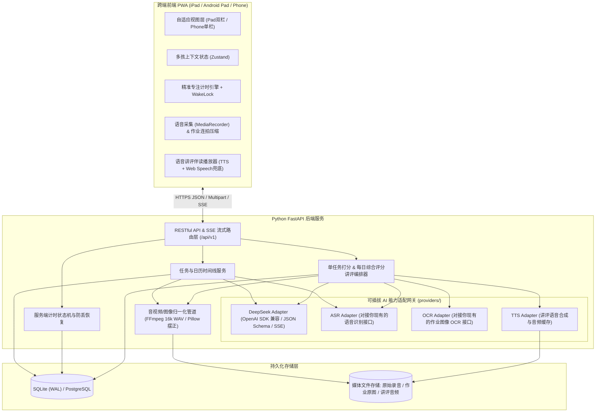
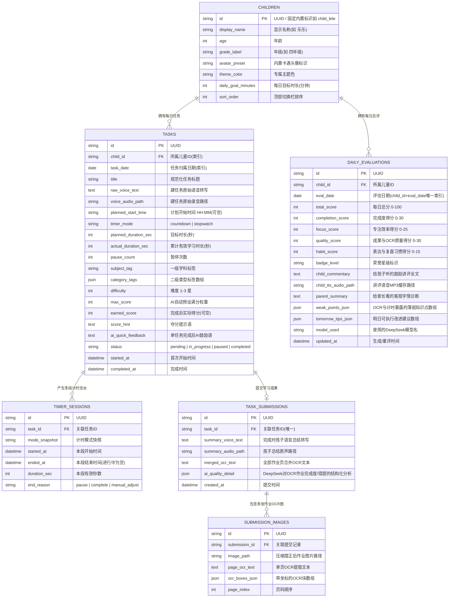

# 小星伴学（StudyDiary）— 前后端技术架构设计文档（v1.0）

## 1. 架构选型总览

基于需求边界（跨 iPad / Android Pad / Phone、免登录内置多孩数据、全语音输入、OCR 全齐备、DeepSeek 评分讲评、已有现成外部 AI 接口），系统采用 **前后端分离 + 可插拔 AI 能力网关（Adapter Pattern）** 架构：

| 层级 | 核心技术栈 | 选型依据 |
|---|---|---|
| **前端（跨端 PWA）** | **React 19 + TypeScript + Vite 6 + Tailwind CSS 4 + Zustand + TanStack Query + vite-plugin-pwa** | 一套代码自适应 iPad/安卓平板双栏与手机单栏；免应用商店审核与苹果开发者签名即可添加到平板主屏幕全屏运行；原生支持录音、相机拍照、屏幕常亮锁（Wake Lock）与 SSE 流式渲染 |
| **后端（API 服务）** | **Python 3.11+ + FastAPI + SQLAlchemy 2.0 (Async) + Pydantic v2 + Alembic** | Python 异步生态轻量高并发，天然适合处理音频转码（FFmpeg/pydub）、图像预处理（Pillow）、OCR 图文坐标解析及 DeepSeek 流式对话编排 |
| **数据与对象存储** | **SQLite 3（WAL 模式） + MinIO 对象存储（`127.0.0.1:9000` 桶 `study-diary`）** | 作业多图（前端压缩长边 `<=1600px`）、OCR 错题局部裁切图、DSH 生成的分步图解 SVG/PNG、原始 WAV 录音与 TTS 音频统一落盘 MinIO |
| **后台异步智能体** | **DeepSeek Harness (`@deepseek-ai/dsh --profile headless`) + DeepSeek 工具 API (`ocr` / `asr` / `tts`)** | 每张作业图仅执行 1 次 `/v1/tools/ocr`；由该儿童专属工作区与 `--session-id` 的 `dsh` 智能体异步完成错题图文讲解、订正复核追分与每日总评，自动维护该儿童长期记忆 |
| **网关与安全上下文** | **Caddy 反向代理（`:443 tls internal` IP 自签名 HTTPS + `:80` 根证书安装引导页）** | 解锁 iPad Safari / Android Pad 浏览器对非 localhost 麦克风 `getUserMedia` 的强制 HTTPS 要求，同时完全保留服务器既有 `:18080` 服务 |

---

## 2. 系统总体架构图



---

## 3. 核心技术难点与工程方案

### 3.1 跨平板/手机全语音输入兼容管道（直通 DeepSeek ASR 16-bit PCM WAV 要求）
- **接口约束（据官方 `/zh-cn/guides/asr`）**：`POST https://api.deepseek.com/v1/tools/asr` 仅接收 **16 位 PCM WAV（8k/16k/22.05k/24k/32k/44.1k/48k Hz）或 Ogg Opus**，单次最大 `8 MiB`、最长 `120 秒`，自动识别中英粤等 20 种语种，返回 `{"request_id", "text", "duration_ms"}`；上传其他格式（如 iPad Safari 默认 `audio/mp4`）会直接返回 `400`。
- **双保险根治方案**：
  1. **前端直采 16kHz 16-bit PCM WAV**：前端 `usePixelVoiceRecorder` 基于 Web Audio API 将麦克风流直接编码为标准 `16000Hz, 16-bit, mono WAV` Blob（同时兼容 iPad Safari 与 Android Pad Chrome），时长控制在 120s 内并实时渲染像素声波柱。
  2. **后端 FFmpeg 兜底校验**：若收到非标准封装音频，经后端 `MediaPipe` 校验/归一化为 16-bit PCM WAV 后调用 `/v1/tools/asr`，并持久化存档音频用于日后成长回听。

### 3.2 DeepSeek 全家桶官方 API 统一网关（`providers/deepseek_suite.py`）
单一 `DEEPSEEK_API_KEY` 覆盖全部四项 AI 能力：

| 能力 | 官方端点与协议 | 关键请求/响应处理要点 |
|---|---|---|
| **ASR 语音识别** | `POST /v1/tools/asr` (`multipart/form-data`, `file=@speech.wav`) | 校验 `<= 8 MiB` & `<= 120s`；解析 `text` 与 `duration_ms`，非 200（400/413/429/503/504）显式上报原因 |
| **OCR 作业识别** | `POST /v1/tools/ocr` (`multipart/form-data`, 仅允许 `file` + `purpose="rich_layout_recognition"`) | 服务端识别期间流式发送前导 `\n` 保活；**注意 HTTP 200 下仍需检查响应 JSON 是否含 `"error"` 字段**；解析 `pages[].text` 中的 `<｜ref｜>...<｜/ref｜><｜box｜>[[x1,y1,x2,y2]]<｜/box｜>`（`0–1000` 归一化坐标），供前端在像素作业本上叠加识别高亮框 |
| **TTS 讲评合成** | 整段：`POST /v1/tools/tts` (`{"text", "voice_id": "stella", "format": "wav"}`)<br>流式：`wss://api.deepseek.com/v1/tools/tts?voice_id=stella&format=pcm` | 默认选用女声 `stella`（海星老师）契合女孩向伴学人设；单次 `<= 10,000` 计费字符；由于服务端不支持语速参数，前端 `<audio>` 通过 `playbackRate`（`0.9x / 1.0x`）实现客户端慢速伴读；检测提前断流视为失败不缓存残缺音频 |
| **Chat 拆解与评分** | `POST /v1/chat/completions` (`deepseek-chat`, `response_format={"type": "json_object"}`) | 负责：① 语音转写拆解单/多任务 + 自动标签 + 100 分制预设权重；② 结合计时与 OCR `<｜ref｜>` 内容给单任务打分；③ 每日四维评分与儿童/家长双视角讲评 |

### 3.3 防刷新/防锁屏的双端精准计时状态机
- **服务端权威时间轴 + 本地秒表插值**：
  - 点击开始计时 → 后端创建 `timer_sessions` 打开记录（记录服务端 `UTC started_at`），任务状态置为 `in_progress`。
  - 计时过程中前端使用 `performance.now()` 结合本地起始偏移渲染流畅的 `60fps` 倒计时/正计时动画，不依赖脆弱的 `setInterval` 累加（彻底避免平板后台节流导致时钟变慢）。
  - 点击暂停或完成 → 后端闭合当前 `timer_session` 分段，精确累加 `actual_duration_sec`。
  - **异常恢复**：页面重新打开或切换回某小孩档案时，自动查询该孩是否存在 `status == 'in_progress'` 的任务；若存在，立即根据 `now - current_session.start_time + accumulated_sec` 无缝还原计时器，一秒不差。

### 3.4 免登录多孩内置数据初始化（Idempotent Seed）
- 后端提供声明式配置文件 `backend/config/builtin_children.yaml`，首次启动时幂等写入（按唯一 `slug` 对齐，重启不覆盖已有学习记录）：
  - 默认内置 `lele`（乐乐·四年级）、`duoduo`（朵朵·二年级）两套独立档案（可随时在配置中增补第三个孩子），并为当天预生成可体验的示例引导或空白干净时间线。
  - 所有业务 API 均通过路径参数或显式查询参数接收 `child_id`（拒绝隐式全局单例状态），前后端彻底杜绝串号。

---

## 4. 数据库模型设计（ER 关系与核心表结构）



---

## 5. DeepSeek 核心智能编排契约（Prompt & JSON Schema）

### 5.1 场景一：语音建任务自动拆解 + 标签分析 + 自动赋分
- **输入**：`ASR 转写文本` + `孩子年级信息` + `当天已有任务列表（用于协调每日 100 分权重与时间冲突）`。
- **DeepSeek 输出 JSON 契约**：
```json
{
  "spoken_confirmation": "帮你把今天的数学和英语任务都安排好啦！先做数学口算20分钟，再背英语单词15分钟。",
  "tasks": [
    {
      "title": "数学口算练习 2 页",
      "planned_start_time": "16:30",
      "timer_mode": "countdown",
      "planned_duration_minutes": 20,
      "subject_tag": "数学",
      "category_tags": ["口算/刷题", "书面作业"],
      "difficulty": 2,
      "suggested_max_score": 30,
      "score_hint": "20分钟内专心算完、字迹清楚就能拿满30分！"
    }
  ]
}
```

### 5.2 场景二：单任务完成评分（结合计时表现 + 语音复盘 + 作业 OCR）
- **输入**：任务计划与实际耗时、暂停次数、孩子语音自述文本、作业图片经 OCR 提取的题目与手写内容全文。
- **DeepSeek 输出 JSON 契约**：
```json
{
  "earned_score": 28,
  "max_score": 30,
  "completion_status": "full",
  "ocr_observations": [
    "识别到两页两位数加减法口算题，约50道题均已填写答案",
    "第2页底部有1处自行涂改订正痕迹"
  ],
  "child_voice_praise": "太厉害啦！比计划提前了2分钟做完，而且你自己检查改对了一道题，奖励你28分！"
}
```

### 5.3 场景三：每日综合评分 + 双视角讲评
- **输入**：该孩当日全部任务的计划/完成状态、总有效学习时长、各任务得分与 OCR 观察摘要、历史近 3 天平均分趋势（用于识别进步）。
- **DeepSeek 输出 JSON 契约**：
```json
{
  "total_score": 92,
  "dimension_scores": {
    "completion": 30,
    "focus": 23,
    "quality": 26,
    "habit": 13
  },
  "badge_level": "super_star",
  "child_commentary": "乐乐，今天你拿到了92分超级学霸星！最让老师惊喜的是数学口算，不仅没超时，还自己抓出了一只粗心小虫子；英语课文也大声读满15分钟啦。写语文生字的时候中途暂停了两次，明天我们先把水喝饱再坐下写字，争取一鼓作气写完好不好？",
  "parent_summary": "今日共完成4项学习任务，累计有效专注74分钟。计算熟练度良好，生字书写阶段注意力略有分散（中途暂停2次，超时4分钟）。",
  "weak_points": ["语文生字左右结构书写耗时较长", "数学退位减法偶有粗心涂改"],
  "tomorrow_tips": ["语文写字前先完成喝水准备，减少中途离座", "口算前先复习2道退位减法热身"]
}
```

---

## 6. 核心 API 接口规划（`/api/v1`）

| 领域 | 方法与路径 | 说明 |
|---|---|---|
| **内置儿童档案** | `GET /api/v1/children` | 获取全部内置小孩档案及今日简要状态（今日任务数、已学时长、今日得分） |
| | `PATCH /api/v1/children/{child_id}` | 家长模式下微调孩子昵称、年级、头像或每日目标时长 |
| **日历与时间线** | `GET /api/v1/children/{child_id}/calendar?start=YYYY-MM-DD&end=YYYY-MM-DD` | 获取周/月日历聚合数据（每日完成进度、总时长、每日总分与勋章） |
| | `GET /api/v1/children/{child_id}/timeline?date=YYYY-MM-DD` | 获取指定日期完整任务时间线（含关联提交结果、OCR 缩略图、计时活跃态） |
| **全语音建任务** | `POST /api/v1/asr/transcribe` | 通用语音转文字接口（上传录音音频，返回转写文本与存档音频 URL） |
| | `POST /api/v1/children/{child_id}/tasks/voice-draft` | 上传语音（或增量修改语音+原草稿），经 ASR + DeepSeek 返回结构化任务草稿卡片 |
| | `POST /api/v1/children/{child_id}/tasks/batch` | 小孩点击确认后，批量落库保存时间线任务并自动重平衡当日任务满分占比 |
| | `PATCH / DELETE /api/v1/tasks/{task_id}` | 修改任务模式/时长或删除任务 |
| **专注计时器** | `POST /api/v1/tasks/{task_id}/timer/start` | 开启/恢复正计时或倒计时（返回权威服务端起始时间戳） |
| | `POST /api/v1/tasks/{task_id}/timer/pause` | 暂停计时并结算当前分段有效秒数 |
| | `GET /api/v1/children/{child_id}/timer/active` | 查询当前小孩是否有未结束的活跃计时任务（用于打开 App 断线秒级恢复） |
| **OCR 交作业** | `POST /api/v1/ocr/preview` | 上传单张或多张作业图，立即执行摆正压缩 + OCR 识别，返回提取文本与坐标框预览 |
| | `POST /api/v1/tasks/{task_id}/complete` | 提交完成（绑定 OCR 图片列表 + 完成感想语音），触发 DeepSeek 单任务即时打分与鼓励语 |
| **每日评分讲评** | `GET /api/v1/children/{child_id}/evaluations/{date}` | 获取某日已生成的评分报告与讲评音频 |
| | `POST /api/v1/children/{child_id}/evaluations/{date}/stream` | **SSE 流式接口**：触发 DeepSeek 生成/更新当日综合评分与双视角讲评，并异步合成 TTS 语音 |
| **家长看板统计** | `GET /api/v1/parent/overview?days=7` | 跨儿童近 7/30 天学习时长趋势、学科分布、平均分曲线汇总 |

---

## 7. 项目工程目录规划与实施路线图

### 7.1 推荐代码仓库结构
```text
study_diary/
├── docs/                           # 产品、设计与架构文档
│   ├── 01-product-requirements.md
│   ├── 02-ui-ux-design.md
│   └── 03-technical-architecture.md
├── backend/                        # Python FastAPI 服务端
│   ├── config/
│   │   └── builtin_children.yaml   # 内置多孩默认档案配置
│   ├── app/
│   │   ├── main.py                 # FastAPI 入口与静态媒体挂载
│   │   ├── core/                   # 配置校验 (.env)、数据库引擎、统一显式错误处理
│   │   ├── models/                 # SQLAlchemy ORM 表模型
│   │   ├── schemas/                # Pydantic v2 请求响应与 DeepSeek JSON 契约
│   │   ├── providers/              # 可插拔外部接口层 (deepseek / asr / ocr / tts)
│   │   ├── services/               # 业务逻辑 (日历聚合、语音建任务、计时状态机、评分编排)
│   │   └── api/                    # /api/v1 路由模块
│   ├── media/                      # 本地持久化目录 (audio / homework_images / tts_cache)
│   └── tests/                      # 后端单元与端到端接口测试
├── frontend/                       # React + TS + Tailwind 跨端 PWA 前端
│   ├── public/                     # PWA manifest、iPad/Android 图标与音效素材
│   └── src/
│       ├── components/             # 适儿化大组件 (头像切换栏、周月日历、时间线卡片、声波录音器)
│       ├── features/
│       │   ├── timeline/           # 日历与每日任务时间线视图 (Pad双栏 & Phone自适应)
│       │   ├── voice-task/         # 全语音建任务与卡片确认弹窗
│       │   ├── focus-timer/        # 全屏正/倒计时专注舱 + WakeLock
│       │   ├── homework-submit/    # 拍作业 OCR 预览 + 语音总结交作业
│       │   ├── daily-review/       # DeepSeek 每日成绩单 + 伴读高亮播放器
│       │   └── parent-board/       # 家长多孩总览看板
│       ├── hooks/                  # useVoiceRecorder, usePreciseTimer, useWakeLock
│       └── stores/                 # 当前选中儿童档案与活跃计时状态
└── docker-compose.yml              # 一键容器化前后端编排部署
```

### 7.2 分阶段研发实施计划（Milestones）
1. **Phase 1 — 地基与核心时间线闭环**：初始化 FastAPI + SQLite 后端与内置多孩 Seed；搭建响应式 PWA 前端骨架（iPad 双栏 / 手机单栏自适应），跑通「切换小孩 → 周/月日历 → 每日任务时间线 → 全屏正/倒计时器（含断线恢复）」。
2. **Phase 2 — 全语音建任务与 DeepSeek 自动标签/赋分**：打通跨端录音转码管道，对接你的现成 ASR 与 DeepSeek 接口，实现「一句话语音拆解单/多任务 → 自动打标签与预设分值 → 语音二次微调入库」。
3. **Phase 3 — 拍作业 OCR + 单任务打分 + 每日讲评伴读**：打通相机连拍压缩与你现有的 OCR 接口，实现交作业全语音汇报 + OCR 识别入库，完成 DeepSeek 单任务即时反馈、每日四维总评 SSE 流式输出及语音讲评播报。
4. **Phase 4 — 家长看板与多端真机体验验收**：完善长按进入的家长多孩数据统计看板、PWA 桌面安装配置、屏幕常亮锁及全链路异常显式提示与端到端测试。
